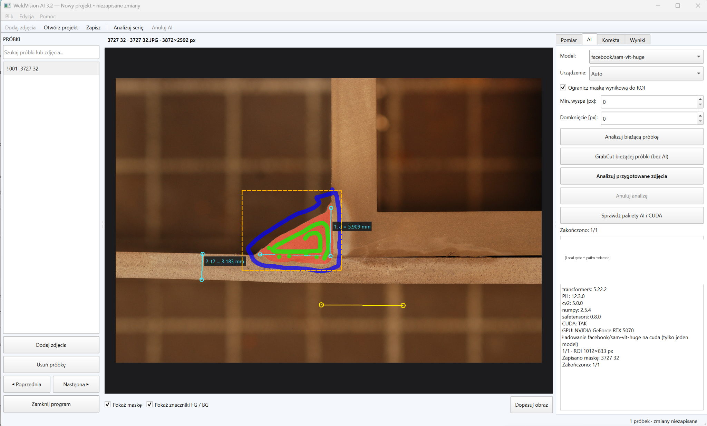

> **Open source:** GNU GPL-3.0-only (kod źródłowy). Zobacz [LICENSE](LICENSE), [prawa i wkład AI](AI_ASSISTED_DEVELOPMENT.md) oraz [licencje komponentów](THIRD_PARTY_COMPONENTS.md).
>
> **Zrzut ekranu:** [podgląd aplikacji](docs/screenshots/weldvision-ai-3.2.jpg) — właściciel wyraził zgodę na publikację; fotografia i zrzut nie są objęte GPL kodu.
>
> **Bezpieczeństwo:** [przegląd przed publikacją](RELEASE_SECURITY_REVIEW_2026-11-17.md).

# WeldVision AI 3.2 — pomiary grubości i przekrojów spoin

**Kalibracja i pomiary liniowe (10 listopada 2026)**

## Nowe pomiary po kalibracji

1. W zakładce **Pomiar** wpisz znaną długość (np. 10 mm), kliknij **Wskaż 2 punkty kalibracyjne** i wskaż dwa różne punkty na zdjęciu. Karta pozostaje na zakładce Pomiar.
2. W grupie **Grubość spoiny i blach** wybierz rodzaj wymiaru i kliknij **Wskaż punkty pomiarowe**.
3. **Grubość spoiny a:** wskaż kolejno grań spoiny, następnie dwa końce odcinka lica. Wynik to odległość prostopadła od grani do prostej lica; rzut musi znajdować się między wskazanymi końcami lica. Narzędzie opisuje geometrię wskazanego trójkąta. Przy zakrzywionym lub nieregularnym licu interpretacja wymaga oceny operatora; do pomiaru lokalnego odcinka użyj Odcinek dowolny.
4. **Grubość blachy t₁ / t₂:** wskaż dwa przeciwległe brzegi odpowiedniej blachy w kierunku prostopadłym do jej powierzchni. Wynik jest odległością między wskazanymi punktami.
5. Wymiary pojawią się na zdjęciu i w tabeli w milimetrach. Możesz wykonać wiele pomiarów jednego typu. **Esc** lub prawy przycisk myszy anuluje rozpoczęte wskazywanie. **Usuń wybrany** usuwa zaznaczony wiersz, a Ctrl+Z / Ctrl+Y cofa i ponawia edycję.

Pomiary nie wymagają maski ani analizy AI. Każda próbka ma własne punkty i wymiary. Zmiana kalibracji przelicza wymiary z oryginalnych współrzędnych pikseli. Powiększanie i przesuwanie zdjęcia nie zmieniają wyniku. Dokładność zależy od jakości zdjęcia, kalibracji i wskazania punktów; zapis trzech miejsc po przecinku nie określa niepewności pomiaru.

Zapis projektu `.weldproj` obejmuje punkty pomiarowe. Eksport zawiera dodatkowo **pomiary_liniowe.csv** (typ wymiaru, wartość mm, skala i współrzędne punktów) oraz obraz z naniesionymi wymiarami. Projekty v1/v2 z poprzednich wersji otwierają się bez pomiarów liniowych. Projekty z nowymi pomiarami zapisuj w wersji 3.2; wcześniejsze wydania nie zachowują tych dodatkowych danych.

Jeśli wersja 3.1 już działa, rozpakuj tę paczkę do nowego folderu i uruchom **Start_WeldVision_AI.bat**. Wspólne środowisko aplikacji może być użyte ponownie; dodane pomiary nie wymagają nowych bibliotek.

Aplikacja z polskim interfejsem do analizy zdjęć makroskopowych spoin, kalibracji skali, pomiaru pola przekroju i oszacowania masy materiału przekroju na 1 m. Obsługuje wiele zdjęć w jednym projekcie, ręczną korektę masek, GrabCut bez AI oraz Segment Anything (SAM) na NVIDIA CUDA lub CPU.

## Instalacja — Windows 11

1. **Nie nadpisuj poprzedniego katalogu programu.** Rozpakuj ZIP do nowego folderu, np. `D:\WeldVision_AI_3_2`. Projekt `.weldproj` zachowaj w osobnym miejscu.
2. Uruchom **`Install_WeldVision_AI.bat`** dwuklikiem. Instalator tworzy dedykowane środowisko w `%LOCALAPPDATA%\WeldVisionAI\venv`, więc pliki programu mogą znajdować się również na dysku Y: / udziale sieciowym.
3. Po poprawnym zakończeniu instalacji uruchom **`Start_WeldVision_AI.bat`**. Jeśli działa, możesz później korzystać z **`Start_WeldVision_AI.vbs`** (bez widocznej konsoli).
4. Przy pierwszej segmentacji SAM wybrany model zostanie pobrany z Hugging Face (wymagany internet). Ponowne uruchomienie korzysta z cache modelu.

Instalator `Install_WeldVision_AI.bat` instaluje program oraz AI/CUDA. Jeżeli chcesz początkowo korzystać bez PyTorch, uruchom wyłącznie `Install_Base.bat`: GrabCut pozostaje dostępny.

> Jeśli PyTorch CUDA 13.0 nie jest dostępny dla Twojej wersji Pythona / sterownika, instalator pokaże błąd. Nie oznacza to, że musisz reinstalować cały Windows lub program. Zaktualizuj sterownik NVIDIA i sprawdź kompatybilną wersję PyTorch. Nie korzystaj z przypadkowych źródeł paczek.

## Układ programu

- **Lewa kolumna — Próbki:** lista z nazwami, wyszukiwarka, statusy, poprzednia/następna próbka. Zmiany ROI, FG, BG, skali i maski pozostają osobno dla każdej próbki.
- **Środek — Obraz:** powiększanie kółkiem, przesuwanie, maska oraz widoczność znaczników.
- **Prawa kolumna — zakładki:** `Pomiar` (kalibracja, gęstość), `AI` (model, GPU, zadania, diagnostyka), `Korekta` (ROI, FG/BG, pędzle, cofanie), `Wyniki` (pole, masa i tabela wyników).
- **Pasek na górze:** dodaj zdjęcia, otwórz/zapisz projekt, analizuj serię, anuluj.

Gdy kontrolki po prawej nie mieszczą się w oknie, zwiększ okno albo szerokość panelu przeciągając **separator między kolumnami**.

## Typowy przebieg analizy

1. Kliknij `Dodaj zdjęcia` i wybierz wiele JPG/PNG/TIFF.
2. Na karcie `Pomiar` podaj długość rzeczywistą (np. 10 mm), kliknij `Wskaż 2 punkty kalibracyjne` i kliknij ich położenia na obrazie. Zmiana długości po kalibracji przelicza skalę i wyniki.
3. Na karcie `Korekta` zaznacz prostokąt `ROI`. W razie potrzeby narysuj `FG +` (spoina) i `BG −` (tło).
4. Ustaw model SAM (domyślnie `sam-vit-large`) i urządzenie `CUDA (GPU)` albo `Auto`. Kliknij `Analizuj bieżącą próbkę` lub `Analizuj przygotowane zdjęcia`.
5. Skoryguj maskę pędzlami / wielokątem. Cofnij `Ctrl+Z` lub ponów `Ctrl+Y`.
6. Obejrzyj wynik i kliknij `Zatwierdź pomiar` na karcie `Korekta`.
7. Zapisz projekt `Ctrl+S`, a w razie potrzeby eksportuj obrazy i wyniki CSV.

Ważne: **AI nie zastępuje weryfikacji przez użytkownika**. Wynik po AI otrzymuje status `Wymaga weryfikacji`, nie `Zatwierdzona`. Ponowna analiza wsadowa pomija już zatwierdzone próbki.

## Zapamiętywanie i bezpieczeństwo danych

- Projekt `.weldproj` **zawiera oryginalne zdjęcia**, markery, ROI, skalę, gęstość i wyniki. Nie trzeba trzymać oryginalnych zdjęć w tym samym folderze po zapisie projektu.
- Zapis jest atomowy: nowy ZIP powstaje osobno, jest weryfikowany i dopiero zastępuje projekt. Poprzednia wersja jest kopiowana do `.weldproj.bak`.
- Program pyta o niezapisane zmiany przed zamknięciem i otwarciem innego projektu.
- Automatyczna kopia odzyskiwania powstaje co **2 minuty** przy zmianach i braku aktywnej analizy AI. Folder kopii na dysku lokalnym: `%LOCALAPPDATA%\WeldVisionAI\recovery` (dla niezapisanego projektu).
- Projekty wcześniejszego formatu v1 można otworzyć w v3.1 i zapisać jako nowy plik v2. **Zachowaj kopię starego projektu** podczas migracji.
- Próbki mają stabilne identyfikatory, dlatego wyniki pracującego AI nie są przypisywane wyłącznie według aktualnego numeru na liście.

## CUDA / RTX 5070 i analiza wsadowa

- `Sprawdź pakiety AI i CUDA` pokazuje **konkretny interpreter Pythona** oraz `torch`, `transformers` i widoczność GPU. Procesy główne i robocze korzystają z tego samego środowiska.
- SAM i GrabCut pracują w oddzielnych procesach. Awaria obliczeń powinna pozostawić otwarte GUI. Proces można przerwać przyciskiem `Anuluj analizę`.
- Przy 12 GB VRAM zacznij od **SAM Large** i niewielkiego ROI. Huge jest dużo bardziej wymagający; nie gwarantujemy, że zmieści się w pamięci dla każdego zdjęcia i sterownika.
- GrabCut działa także bez instalowania `torch` i `transformers`.
- Testy GPU i AI na Windows/RTX 5070 wymagają sprawdzenia na Twoim komputerze; środowisko przygotowania paczki nie miało tej karty.

## Interpretacja pomiaru

Dla liczby zaznaczonych pikseli `N`, skali `s [mm/piksel]` i gęstości `ρ [g/cm³]`:

- `A [mm²] = N × s²`
- `V [cm³/m] = A [mm²]` (dla 1 m i stałego przekroju)
- `m [kg/m] = A × ρ / 1000`

**To oszacowana masa materiału zaznaczonego przekroju**, nie automatycznie rzeczywisty uzysk stopiwa ani zużycie drutu (maskowany przekrój może obejmować przetopiony materiał rodzimy). Zatwierdzenie wyniku należy do użytkownika.

## Klawisze

`Ctrl+O` — dodaj zdjęcia; `Ctrl+Shift+O` — otwórz projekt; `Ctrl+S` — zapisz; `Ctrl+Shift+S` — zapisz jako; `Ctrl+Z`/`Ctrl+Y` — cofnij/ponów; `Alt+←`/`Alt+→` — poprzednia/następna próbka; `Ctrl+Q` — zamknij.

## Diagnostyka i testy

- `Sprawdz_srodowisko_AI.bat` — sprawdza Python, pakiety oraz CUDA.
- `Uruchom_testy.bat` — uruchamia testy regresyjne; wymaga instalacji pytest.
- `weldvision_start_error.log` — błędy startu (w folderze programu); `weldvision_ai_error.log` — błędy AI (folder odzyskiwania).
- W razie problemu uruchom wersję `.bat` zamiast `.vbs`, aby zobaczyć komunikat.

**Zachowaj starą działającą wersję oraz kopię projektu przed pierwszym użyciem 3.1.**
