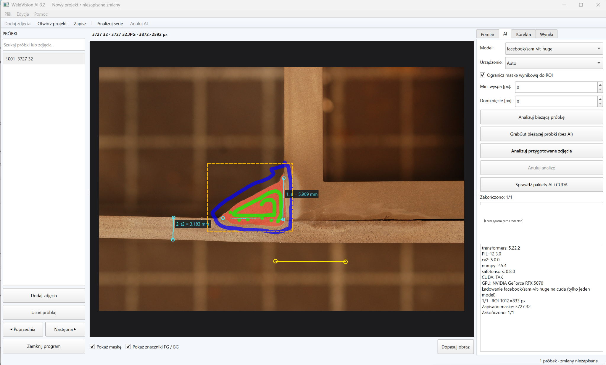

> **Open source:** original application source is licensed under GNU GPL-3.0-only. See [LICENSE](LICENSE), [AI-assisted development](AI_ASSISTED_DEVELOPMENT.md), and [third-party licensing](THIRD_PARTY_COMPONENTS.md).
>
> **Screenshot:** [WeldVision 3.2 in action](docs/screenshots/weldvision-ai-3.2.jpg); published with the image owner's permission, not licensed under the source-code GPL.

# WeldVision AI 3.2 — Weld Macrograph Analysis and Measurement

**WeldVision AI** is an open-source Windows desktop application for analyzing macrographs of welded joints. It combines **image calibration and geometric measurements** with optional AI-assisted image segmentation for research and laboratory documentation.

## What does it do?

- **Manage weld macrographs:** import multiple images, organize samples and save ongoing work.
- **Calibrate image scale:** convert pixels to millimetres using two reference points and a known distance (e.g., 10 mm).
- **Measure fillet weld geometry:** mark weld throat `a`, plate thickness `t1`/`t2` and arbitrary distances directly on images.
- **Segment weld regions:** use OpenCV GrabCut or Segment Anything (SAM), optionally accelerated with NVIDIA CUDA; adjust ROI and foreground/background prompts.
- **Review and edit masks:** manually correct segmentation and approve results.
- **Calculate cross-sectional area and estimate material mass per metre:** based on mask area, calibration and user-defined density; not direct filler-wire consumption.
- **Save and export:** `.weldproj` projects, annotated/mask images and CSV measurement tables.

**Typical workflow:** import macrograph → calibrate → define ROI and segment or measure manually → review → approve → save/export.

> **Research limitation:** This is not a certified metrology system or an automated weld-acceptance evaluator. Results depend on image quality, calibration and operator judgement; AI outputs must be verified.

## Further functionality and installation

- Import and organize multiple macrograph images in one project.
- Calibrate pixel scale with two reference points and a known distance.
- Measure selected geometric distances: fillet weld throat **a**, plate thickness **t1/t2**, and arbitrary segments.
- Measure areas and estimate section-material mass per metre using operator-defined density.
- Segment selected regions via OpenCV GrabCut or optional Segment Anything (SAM).
- Revise masks manually, review and approve results, save projects and export CSV/image reports.

## Installation and testing

The application targets Windows 11 and Python 3.13. For details, consult the main [Polish README](README.md). `Install_Base.bat` installs the GUI and image-processing dependencies in a dedicated local virtual environment; GPU-based AI is optional. To run automated tests, install `pytest` and execute `python -m pytest -q tests` in the project directory.

## Research limitations

This is **research software**, not an independently certified metrology system. Results depend on calibration, the selected points/masks, image quality and operator review. The number of displayed decimal places is not an uncertainty statement. AI-generated segmentation should be independently verified. The application does not establish welding compliance or acceptance grades without separate, applicable criteria.

## Source-code and datasets

The repository intentionally does **not** contain laboratory photographs, patient/personal data, confidential reports, trained model weights, or `.weldproj` research projects. Avoid committing such files. The models referenced by code are obtained separately from their respective publishers.

## License and development provenance

The original application source is licensed under **GNU GPL-3.0-only**; see [LICENSE](LICENSE). Dependencies and model weights retain their own licenses. See [third-party components](THIRD_PARTY_COMPONENTS.md) and [AI-assisted development](AI_ASSISTED_DEVELOPMENT.md). The concept, functional requirements and real-world testing were directed by the human maintainer; AI tools assisted with software development.
